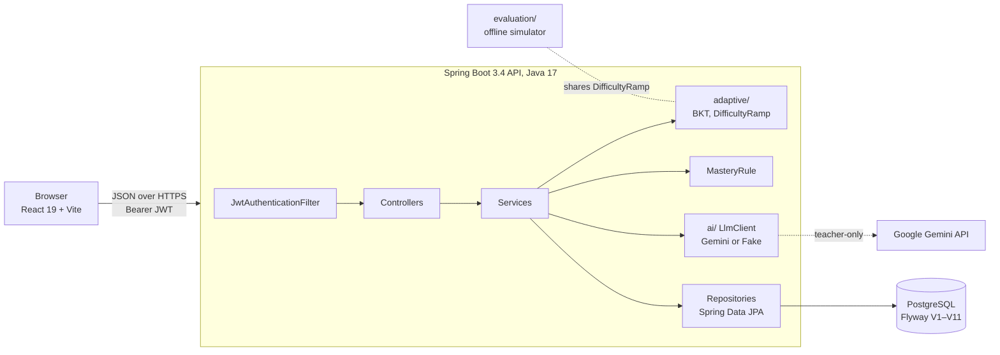
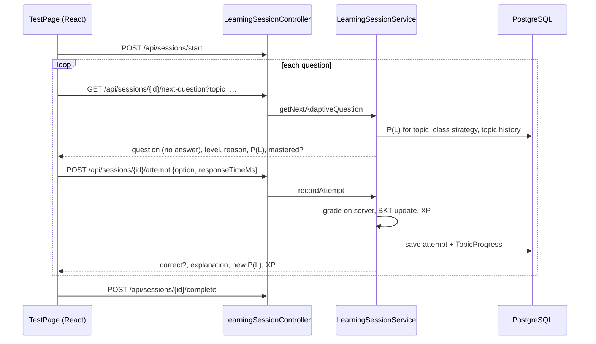

# NeuroLearn — Project Guide and Design Defence

A single document for explaining NeuroLearn to an examiner: what it does, how every part works, what
research it builds on, why each design choice was made, and how to answer the hard questions.

Related documents: [README.md](../README.md) (full vision), [evaluation.md](evaluation.md) (Evaluation 1:
simulation study), [evaluation_attention.md](evaluation_attention.md) (Evaluation 2: inattentive learners), [deployment.md](deployment.md), [AI_FUTURE_SCOPE.md](AI_FUTURE_SCOPE.md),
[FUTURE_WORKFLOW.md](../FUTURE_WORKFLOW.md) (phase plan).

---

## 1. The 60-second pitch

NeuroLearn is a gamified, adaptive maths practice app for class 9–10 students (linear and quadratic
equations), designed to be friendly to learners who struggle with attention and frustration. Students
play through a superhero-themed roadmap. After every answer the system updates an estimate of what the
student knows (Bayesian Knowledge Tracing) and chooses the difficulty of the next question with an
adaptive ramp. Teachers manage classes, see where their class gets stuck, and generate new questions
with an AI pipeline that checks its own answers and needs teacher approval. Parents see a report card.

What makes it more than a CRUD app:
1. **A real student model** (BKT) running on every answer.
2. **An evaluation harness**: a simulator of 5,000 students that compared seven difficulty policies.
   It showed the original BKT engine lost to a simple fixed sequence, which led to the adaptive ramp now
   in the app and a stricter "Mastered" rule.
3. **A safe AI pipeline**: generate → validate in code → independent self-check → teacher review.

---

## 2. Where the project came from and how it changed

| Stage | What it was | Why it changed |
|---|---|---|
| Prototype (`legacy-python/`) | Flask app with webcam eye-tracking, an LSTM "attention state" model and an LSTM mastery predictor, aimed at ADHD pre-screening | Webcam monitoring of children is invasive and, under India's DPDP Act, behavioural monitoring of children is not allowed. Response-time patterns are **not specific to ADHD** for an individual child, so a "risk flag" would be unreliable and could harm. The LSTM had no real training data. |
| Rewrite (current) | Spring Boot + React + PostgreSQL, BKT student model, gamified roadmap | A maintainable, testable system with an explainable model instead of an unvalidated black box |
| Phase 5 | Simulation study of difficulty policies | To check whether the adaptivity actually helps (it didn't, at first) |
| Phases 4b–6 | AI question generation, per-class difficulty strategy, Docker, cloud deployment | Content scale, a pilot-ready comparison, and a live demo |

**How to phrase the ADHD part:** NeuroLearn is *ADHD-friendly by design* (short sessions, instant
feedback, game rewards, fewer too-hard questions), **not** a diagnostic or screening tool. (A
low-motion "calm mode" exists only as CSS (`body.calm` in `index.css`); no button turns it on yet, so
don't demo it as a feature.) The
decision not to label children is recorded in the README ("Decision, November 2026") and FUTURE_WORKFLOW
Phase 7. Dropping a feature for ethical and evidence reasons is a design decision you can defend.

---

## 3. Architecture

A classic **layered architecture**: Controller (HTTP) → Service (business rules) → Repository (data) →
Database. Each layer only talks to the one below it.

| Layer | Technology | Where |
|---|---|---|
| Frontend | React 19, Vite 7, Tailwind CSS 3, plain `fetch` | `Frontend/src/` |
| API | Spring Boot 3.4.3 (Web, Security, Data JPA, Validation), Java 17 | `backend-java/src/main/java/com/neurolearn/` |
| Auth | Spring Security, JWT (jjwt 0.12, HS256), BCrypt password hashing | `security/`, `config/SecurityConfig.java` |
| Database | PostgreSQL 16 (Neon in the cloud), schema by Flyway migrations | `src/main/resources/db/migration/` |
| AI | Google Gemini via REST, behind an `LlmClient` interface; offline `FakeLlmClient` by default | `ai/` |
| Tests | JUnit 5, AssertJ, Spring Boot Test, Testcontainers (real Postgres) | `backend-java/src/test/` |
| Delivery | GitHub Actions CI, Docker (multi-stage), Docker Compose, Vercel + Render + Neon | `.github/workflows/ci.yml`, `docker-compose.yml`, `docs/deployment.md` |

### Backend package map

| Package | Responsibility |
|---|---|
| `controller/` | REST endpoints. Thin: read the request, get the logged-in user, call a service. |
| `service/` | Business logic: sessions, grading, progress, classes, teacher analytics, parent reports, question generation, `MasteryRule`. |
| `adaptive/` | The student model and difficulty policies: `AdaptiveEngineService` (BKT), `DifficultyRamp`, `BktParameters`. |
| `ai/` | `LlmClient` interface, `GeminiLlmClient`, `FakeLlmClient`, `QuestionCandidate` validation, `MathText` (LaTeX → plain text). |
| `entity/` | JPA entities mapped to tables (User, StudentProfile, Question, QuestionAttempt, TopicProgress, SchoolClass…). |
| `repository/` | Spring Data interfaces; custom JPQL where needed (e.g. "approved questions only"). |
| `dto/` | Request and response shapes, so entities (e.g. password hashes, correct answers) never leak to the client. |
| `security/` | JWT creation/validation, the request filter, user loading. |
| `exception/` | `GlobalExceptionHandler` turns exceptions into consistent JSON errors (400/401/403/404/429). |
| `evaluation/` | Offline research code: simulator, policies, BKT fitter. Not used at runtime. |

### Frontend map

| File | Role |
|---|---|
| `App.jsx` | Chooses the page from state (`home`, `roadmap`, `learn`, `test`, `feedback`, `dashboard`, `auth`, `boss`); unauthenticated users are sent to login. |
| `context/AuthContext.jsx` | Holds the logged-in user and token (in `localStorage`). |
| `utils/api.js` | One `fetch` wrapper: adds `Authorization: Bearer …`, reads `VITE_API_BASE`, logs out on 401. |
| `pages/` | Roadmap, quiz (`TestPage`), boss fights, feedback, role dashboards (student/teacher/parent). |
| `components/` | Navbar, character reaction popups, teacher question bank (`QuestionBankPanel`). |
| `data/chapters.js` | Chapter and section structure of the roadmap. |

---

## 4. How a request flows (the walkthroughs to explain)

### 4.1 Login

1. `AuthPage` posts email + password to `POST /api/auth/login`.
2. `AuthService` loads the user, checks the password against the **BCrypt hash**.
3. `JwtTokenProvider` signs a token (HS256, 24 h expiry; the server refuses to start if `JWT_SECRET` is
   shorter than 32 bytes).
4. The browser stores the token; every later request carries it.
5. On each request `JwtAuthenticationFilter` validates the token and sets the user and role.
   `SecurityConfig` then enforces **role-based access**: `/api/teacher/**` needs TEACHER,
   `/api/parent/**` PARENT, `/api/sessions/**` STUDENT, and anything not listed is **denied by default**.

### 4.2 One question in a learning session (the core loop)

Inside `LearningSessionService.getNextAdaptiveQuestion`:
1. **Ownership check**: 404 if the session doesn't exist, 403 if it belongs to another student.
2. Read the student's current knowledge estimate P(L) for the topic (`TopicProgress.pKnow`, default 0.20).
3. Run BKT's decision (always, because P(L) feeds the mastery badge and dashboards).
4. Find the **class strategy** (`ClassService.strategyForStudent`): `ADAPTIVE_RAMP` (default),
   `FIXED_RAMP` or `BKT_THRESHOLDS`.
5. For the ramps, **replay the student's whole history on this topic** through `DifficultyRamp` to get
   the level, so progress carries across sessions.
6. Pick a random **approved**, not-yet-seen question at that level, in the student's chosen hero theme,
   with fallbacks (any theme, any level) so a student never gets stuck.
7. Remember *why* this question was served (action, reason, strategy) on the session; it is copied onto
   the attempt for later analysis.
8. Return the question **without the correct answer** (`QuestionResponse.forStudent`).

Inside `recordAttempt`:
1. **Grade on the server** (the client never knows the answer, so it can't cheat).
2. Log the attempt: selected option, hints used, response time, level served, strategy and reason.
3. Award XP (15 correct, 5 for trying; level = XP / 100 + 1).
4. **BKT update** of P(L) (with a higher guess probability if the 50:50 hint was used, §5.1).
5. Return correctness, explanation, new P(L) and whether the topic is now **Mastered** (`MasteryRule`).

Hints (`POST /api/sessions/{id}/hints`): the server decides which two wrong options a 50:50 removes,
records the hint, and refuses hints after the question is answered.

### 4.3 Teacher: classes, strategy, analytics

- Teacher creates a class (gets a join code); students join with the code (`/api/student/classes/join`).
- Teacher can set the class's **difficulty strategy** (`PUT /api/teacher/classes/{id}/strategy`).
- Analytics (`/api/teacher/analytics`) only cover students enrolled in **that teacher's** classes: roster
  with accuracy and mastery, and **topic bottlenecks** (where the class is weakest).

### 4.4 Teacher: AI question generation (`QuestionGenerationService`)

1. Teacher picks topic, difficulty, hero theme and count. Limits: known topics/themes only, **40
   questions per teacher per 24 h** (cost and abuse guard).
2. **Generate** (temperature 0.8) with a strict JSON schema; the prompt includes curriculum rules and
   requires each wrong option to come from a named student mistake.
3. **Validate in code**: four distinct options, one correct key, no LaTeX (converted by `MathText`),
   mistakes present for wrong options, **no duplicates** of existing questions.
4. **Self-check**: a second, independent call (temperature 0.0) solves each question; a question is kept
   only if the solver's answer agrees with the generator's.
5. Save survivors as **PENDING** with provenance (model, prompt version, creator). Students are only ever
   served **APPROVED** questions; a teacher reviews, edits, approves or rejects (`/api/teacher/questions`).
6. **No student data is sent to the model**, only curriculum content.

### 4.5 Parent

A parent links to a child (`/api/parent/link`) and sees a report card per topic
(`/api/parent/child/{id}`): progress, accuracy and mastery, read-only.

---

## 5. Models and algorithms

### 5.1 Bayesian Knowledge Tracing (the student model)

Source: Corbett & Anderson (1995). Each topic is one skill that is either *known* or *not known*.
P(L) is the probability it is known. Code: `adaptive/AdaptiveEngineService.java`.

Parameters (`BktParameters.defaultParameters()`): P(L₀) = 0.20 (prior), P(T) = 0.18 (learn per
attempt), P(G) = 0.25 (guess, 4 options), P(S) = 0.10 (slip), mastery threshold 0.85.

After a **correct** answer:
P(L | correct) = P(L)(1 − S) / [P(L)(1 − S) + (1 − P(L))·G]

After a **wrong** answer:
P(L | wrong) = P(L)·S / [P(L)·S + (1 − P(L))(1 − G)]

Then learning: P(L)new = P(L | obs) + (1 − P(L | obs))·T, clamped to [0.01, 0.99].
Predicted chance of getting the next one right: P(L)(1 − S) + (1 − P(L))·G.

**Own extension:** when the 50:50 hint left two options, the guess probability for that answer is 0.5,
so a correct answer after a hint counts as weaker evidence.

**Why BKT:** explainable (every update can be shown as a sentence, which the app does), works from the
first answer with no training data, cheap to run, and the most cited model in intelligent tutoring.
**Known weakness**, found by our own evaluation: BKT ignores item difficulty, so a few correct easy
answers push P(L) over 0.85. That is why "Mastered" now also needs hard questions (§5.3).

### 5.2 Difficulty policy: `DifficultyRamp`

Code: `adaptive/DifficultyRamp.java`. One class used **both by the app and by the simulator**, so the app
runs exactly the rule that was evaluated.

- **Fixed ramp:** 5 questions at level 1, 5 at level 2, then level 3. Ignores answers.
- **Adaptive ramp (default):** same baseline, but
  - 3 correct in a row → skip ahead a level;
  - 2 wrong in a row → restart the count at this level (slow down);
  - 3 wrong in a row → drop back a level.
- Each decision produces a human-readable reason that is shown to the student and logged.

The third option, `BKT_THRESHOLDS` (the original engine: P(L) < 0.40 → level 1, < 0.75 → level 2,
else 3), is kept as an opt-in class strategy for comparison.

### 5.3 Mastery rule

Code: `service/MasteryRule.java`. "Mastered" = **P(L) ≥ 0.85 and at least 2 correct level-3 answers** in
the topic. One definition used everywhere (roadmap badge, dashboards, teacher roster, parent report).

### 5.4 Evaluation-only models (`evaluation/`)

| Model | What it is | Why |
|---|---|---|
| Simulated student | Item response model with guessing: P(correct) = c + (1 − c − s)·σ(a(θ − b)); ability θ grows most on items slightly above the student (zone of proximal development) | Ground truth the policies can't see, so "truly mastered" can be measured |
| Difficulty-aware Elo | Ability estimate updated by surprise, targets 50% success | A stronger, difficulty-aware baseline (like IRT) |
| BKT fitter | Maximum-likelihood fit of P(L₀), P(T), P(G), P(S) (grid search + coordinate refinement, constraints against degenerate fits) | To fit real parameters once there is data; verified by recovering known parameters within ±0.02 |
| Attention lapses | Off-task chance rising with fatigue; an off-task answer is a guess | Stress test for inattentive learners (Evaluation 2, evaluation_attention.md) |

### 5.5 LLM

Google Gemini (model set by `GEMINI_MODEL`), called over REST with a JSON response schema. Behind the
`LlmClient` interface, so tests and offline demos use `FakeLlmClient` and the provider can be swapped.

---

## 6. Research basis

Cite these for the **idea** they support. Sound and safe to cite:

| Reference | Used for |
|---|---|
| Corbett & Anderson (1995), *Knowledge tracing*, User Modeling and User-Adapted Interaction 4(4) | The BKT model and its update equations |
| Baker, Corbett & Aleven (2008), contextual guess/slip, ITS 2008 | Adjusting guess probability by context (our 50:50 adjustment) |
| Pardos & Heffernan (2010), individualised BKT, UMAP 2010 | Why per-student/per-topic parameters matter (future work, fitter is ready) |
| VanLehn (2011), *Relative effectiveness of tutoring systems*, Educational Psychologist 46(4) | Step-based tutoring systems approach human tutoring (effect size ≈ 0.76) |
| Bloom (1984), *The 2 sigma problem*, Educational Researcher 13(6) | Mastery learning as the goal |
| Vygotsky's zone of proximal development | Learning peaks a little above current ability (simulator assumption, varied in sensitivity tests) |
| Elo (1978) / Pelánek (2016) Elo in education; IRT (Lord, 1980) | Difficulty-aware ability estimation (evaluation baseline, future work) |
| Ryan & Deci (2000), *Self-determination theory*, American Psychologist 55(1) | Game elements supporting competence and autonomy |

**Do not quote** the specific statistics in `docs/history/research_and_aiml_scope.md` such as "+14%
retention", "single most effective ADHD accommodation" or "+43% transfer". They could not be verified
against the original papers (see AI_FUTURE_SCOPE.md, "Corrections to the older docs"). If asked, say you
checked and removed unverifiable claims; that shows rigour.

---

## 7. What the evaluations found (short version)

Two separate simulation studies with the same simulator, seven policies, 5,000 simulated students, 30
questions, separate training and test populations, and the same random draws for every policy.

### Evaluation 1: attentive students ([evaluation.md](evaluation.md), six scenarios)

| Finding | Number |
|---|---|
| Original BKT engine loses to a fixed ramp | 61.2% vs 73.4% mastered (baseline) |
| BKT's "Mastered" claim is premature | claimed at a median of question 5; correct 0.0% of the time |
| Adaptive ramp beats the original engine | 6 of 6 scenarios |
| Adaptive ramp vs fixed ramp, weak starters | **45.2% vs 40.7%** mastered |
| Adaptive ramp vs fixed ramp, frustration-prone | **44.0% vs 52.8% quit**, 44.3% vs 42.3% mastered |
| Too-hard questions (baseline) | **25.3% vs 38.3%** |

**Story:** for the *average* student a well-designed fixed sequence is as good as adaptivity. Adaptivity
pays off for the students a fixed sequence loses: weak starters and students who give up.

### Evaluation 2: inattentive students ([evaluation_attention.md](evaluation_attention.md))

Attention lapses that grow with fatigue (10% → 39% off-task over 30 questions); an off-task answer is a guess.

| Finding | Number |
|---|---|
| Fixed ramp gets more to mastery | 52.1% vs 35.0% (adaptive ramp) |
| Adaptive ramp is gentler | 27.7% vs 50.0% too-hard questions |
| Adaptive ramp keeps more students | 59.0% vs 68.0% quit (with quitting) |
| Why | lapse-driven misses hold the adaptive ramp at easier levels (2.46 vs 3.00 at question 30) |

**Story:** adapting to wrong answers isn't enough for inattentive learners; the system has to tell a
lapse from a knowledge gap. The app already logs response time, the most promising signal.

Both are simulations; a two-class pilot design is ready (evaluation.md §7.1).

---

## 8. Design decisions and how to defend them

| Decision | Why | Alternatives considered | Trade-off you accept |
|---|---|---|---|
| **Java 17 + Spring Boot** | Course language; mature ecosystem for security, validation, data access and testing; strong typing for business rules; dependency injection makes services testable | Node/Express, Django, keep Flask prototype | More boilerplate and slower cold start than Node |
| **PostgreSQL** | The data is **relational** (users → profiles → attempts → questions; classes ↔ enrollments ↔ students; parents ↔ children); needs foreign keys, joins, aggregates for analytics and **ACID transactions** for grading + XP + P(L) updates together. Open source, free managed hosting (Neon). | MySQL (would also work; Postgres has stricter SQL, better JSON and window functions); MongoDB (no joins/foreign keys, our analytics are join-heavy); SQLite (no concurrent multi-user writes, not for hosting) | Need a schema migration tool and a running server |
| **Flyway migrations** (`ddl-auto: validate`) | Schema is versioned code (V1–V11), reviewed in Git, identical in dev, test, Docker and cloud; Hibernate only *validates*, never changes the schema | Hibernate auto-update (unsafe, can lose data), Liquibase (heavier) | Every schema change needs a new migration file |
| **JPA / Spring Data** | Less SQL boilerplate; custom JPQL where it matters (approved-only queries, aggregate counts) | Plain JDBC, MyBatis | Must watch N+1 queries (we batch, e.g. `hardCorrectByStudentAndTopic`) |
| **JWT, stateless** | API and frontend are on different hosts; no server session store; scales horizontally | Server sessions with cookies | Can't revoke a token before expiry (24 h); mitigated by short expiry |
| **BCrypt** | Slow, salted, standard password hashing | SHA-256 (too fast, unsafe) | Slightly slower login |
| **Role-based access, deny by default** | Every path must be listed with a role; new endpoints are closed until allowed. Plus ownership checks in services (403 on another student's session) | Checks only in controllers | Each new route needs a security rule |
| **Server-side grading** | The client never receives the correct answer, so it can't be read from the network tab | Grade in the browser (simpler, cheatable) | One extra round trip per answer |
| **DTOs separate from entities** | Never leak password hashes or answers; API can evolve independently of tables | Return entities directly | More classes |
| **BKT as the student model** | Explainable, no training data needed, standard in the literature | Deep Knowledge Tracing / LSTM (the prototype; needs large datasets we don't have, not explainable), IRT (needs ~500 respondents to calibrate) | Ignores item difficulty (fixed with `MasteryRule`) |
| **Adaptive ramp as default** | Best all-round in our simulation; simple rules a teacher can understand | Original engine, Elo, fixed ramp | Not yet validated on real students |
| **One `DifficultyRamp` for app and simulator** | What we evaluated is exactly what runs | Re-implement in both places | — |
| **Strategy per class** | Enables a fair pilot (one class per strategy) and gives teachers control | Global setting, per-student random | Student in several classes gets the most recently joined class's strategy |
| **AI with self-check + teacher approval** | LLMs make maths mistakes; two layers of checking and a human in the loop keep wrong questions away from students | Auto-publish generated questions; no AI | Teacher must review |
| **`LlmClient` interface + fake provider** | Works offline and in CI with no key or cost; provider can be swapped | Call Gemini directly | — |
| **No ADHD / engagement flag** | Not specific to ADHD for an individual; DPDP Act; risk of labelling a child | The original screening idea | Less "flashy" feature, far more defensible |
| **React + Vite + Tailwind** | Component model fits a game UI; Vite is fast; Tailwind keeps styling consistent | Angular (heavier), plain JS | Page switching is done with state instead of a router library (simple, but no deep links) |
| **Docker + Compose** | One command runs DB + API + web identically anywhere | Manual install | Image build time |
| **Vercel + Render + Neon** | Free tiers, each piece on a host built for it (static site / container / Postgres) | One VM; Heroku (no free tier) | Render free tier sleeps: first request after idle is slow |
| **GitHub Actions CI** | Every PR runs backend tests (with a real Postgres via Testcontainers), lint, frontend build and Docker build | Manual testing | — |

---

## 9. Data model

| Table | Holds | Added in |
|---|---|---|
| `users` | name, email, BCrypt hash, role (STUDENT / TEACHER / PARENT) | V1 |
| `student_profiles` | XP, level, accuracy, overall P(L) | V1, V3 |
| `questions` | topic, difficulty 1–3, text, 4 options, answer, explanation, hero theme, status (PENDING/APPROVED/REJECTED), source (SEED/LLM), provenance | V1, V6, V10 |
| `question_misconceptions` | the student mistake behind each wrong option | V10 |
| `learning_sessions` | start/end, accuracy, the last served question's reason and strategy | V1, V9, V11 |
| `question_attempts` | every answer: correct, option, response time, hints, level served, adaptive action/reason, strategy | V1, V9, V11 |
| `topic_progress` | per student and topic: attempts, correct, P(L), mastery score | V1, V3 |
| `session_hint_events` | 50:50 and clue usage, eliminated options | V9 |
| `classes`, `class_enrollments` | teacher classes with join code and difficulty strategy; who is in which class | V8, V11 |
| `parent_student_links` | which parent can see which child | V4 |

Seed migrations: V2 (Batman questions), V5 (demo accounts and history), V6 (Superman theme), V7
(Chapter 2, quadratics).

---

## 10. Security and privacy

- Passwords: BCrypt. Secrets (JWT key, DB password, Gemini key) only in environment variables, never in Git.
- JWT secret must be ≥ 32 bytes or the server won't start.
- Deny-by-default authorization by role, plus ownership checks (a student can't touch another's session;
  a teacher only sees their own classes' students; a parent only linked children).
- Server-side grading; answers never sent before the attempt.
- CORS limited to the deployed frontend's origin.
- AI: only curriculum content goes to the model, never student data; daily generation limit.
- No behavioural labelling of children (§2).

---

## 11. Testing and quality

About 135 automated tests across 17 test classes, plus the application-context test, run in CI on every pull request:
- **Unit:** BKT updates (`BktEngineTest`), ramp rules (`DifficultyRampTest`), progress and teacher rules,
  LLM output parsing and validation, LaTeX cleaning, the simulator and fitter (`EvaluationModelTest`).
- **Integration** (real PostgreSQL via Testcontainers): authorization for every role, classes, difficulty
  strategy, earned mastery, grading and logging, the full learning flow, question generation.
- **Frontend:** ESLint with zero warnings allowed, production build.
- **Docker:** both images must build.

---

## 12. Honest limitations (say them before you're asked)

1. The evaluation is a **simulation**; no real-student study yet. A pilot design is ready.
2. Little real data (60 logged answers), so BKT uses literature-default parameters.
3. BKT treats a topic as one skill and ignores item difficulty (mitigated by `MasteryRule`).
4. Two chapters of content; the AI pipeline is how content scales.
5. Free-tier hosting has cold starts.
6. The adaptive ramp misreads attention lapses as gaps in knowledge (found in Evaluation 2).

---

## 13. Likely viva questions

**Q: Is this an ADHD detection tool?**
No. It started as one, and we deliberately removed screening: behavioural signals like response time are
not specific to ADHD for an individual child, labelling children is harmful, and the DPDP Act restricts
behavioural monitoring of children. It is ADHD-*friendly*: short sessions, instant feedback, rewards,
and a difficulty policy that gives a third fewer too-hard questions.

**Q: Your own evaluation says a fixed sequence is as good. Why is the project useful?**
For the average student, yes. But the adaptive ramp helps exactly the students a fixed sequence fails:
weak starters (45% vs 41% mastered) and students who give up (44% vs 53% quit). And without the
evaluation we would still be running an engine that called students "Mastered" when it was wrong every
time. The evaluation is what made the system better.

**Q: Why PostgreSQL and not MongoDB?**
Our data is relational with many foreign keys and our analytics need joins and aggregates across
attempts, questions, classes and students. Grading, XP and P(L) must update together in one ACID
transaction. A document store would push all of that into application code.

**Q: Why BKT and not deep learning?**
Deep knowledge tracing needs large datasets (tens of thousands of students); we have none. BKT works from
the first answer, is explainable to students and teachers, and is the standard model in the tutoring
literature. Our prototype had an LSTM; we replaced it because it couldn't be trained or explained.

**Q: How do you know the simulator is not biased toward your policy?**
The adaptive ramp's rules were written before it was run, nothing was tuned on the test population,
every policy sees the same students and random draws, and we vary the assumptions in six scenarios (Evaluation 1)
plus a separate inattentive-learner study (Evaluation 2). It loses in some of them (e.g. inattentive learners), and we report that.

**Q: What stops the AI from giving students a wrong question?**
Four layers: a strict JSON schema, validation in code, an independent solve that must agree, and teacher
approval. Students can only ever be served APPROVED questions; that filter is in the repository queries.

**Q: Can a student cheat?**
The answer is never sent to the browser before submitting; grading happens on the server; sessions are
checked for ownership; hints are recorded and can't be used after answering.

**Q: How does the system decide the next question's difficulty?**
Walk through §5.2: replay the student's history in the topic through the ramp; 5 questions per level,
skip ahead on 3 correct, slow down on 2 wrong, drop back on 3 wrong. Show the reason string in the UI.

**Q: What happens with JWT if a token is stolen?**
It's valid until expiry (24 h). The trade-off for a stateless API; mitigations are short expiry, HTTPS
only, and a token blacklist if needed.

**Q: How would you scale it?**
The API is stateless, so run more instances behind a load balancer; the database is the bottleneck, so
add indexes (already on hot paths), a connection pooler and read replicas for analytics.

**Q: What would you do next?**
Run the two-class pilot; fit BKT per topic once data exists; calibrate item difficulty (IRT) to replace
BKT's difficulty-blindness; make the ramp lapse-aware using response time; session completion status.

---

## 14. Demo script (5 minutes)

1. Open the live site a minute early (free tier wakes up slowly).
2. **Student** (`bruce@neurolearn.com`): roadmap → a section → answer a few questions. Point at the
   difficulty reason and the P(L) change after each answer. Back on the roadmap, point at a
   "Beat 2 hard Qs to master" badge (high P(L), mastery not yet earned).
3. Use a 50:50 hint; explain why it counts as weaker evidence.
4. **Teacher**: class roster and topic bottlenecks; switch a class's strategy; generate questions and
   show the rejected list (self-check disagreements) and the approve/reject review.
5. **Parent**: the child's report card.
6. Close on the evaluation chart (`docs/evaluation/mastery_by_scenario.png`) and the limitations.
