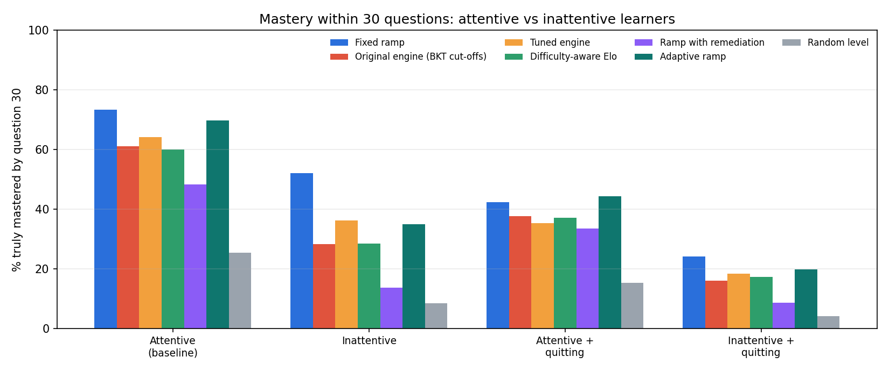
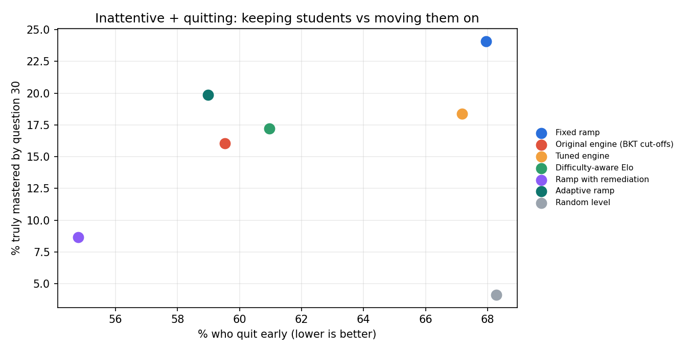
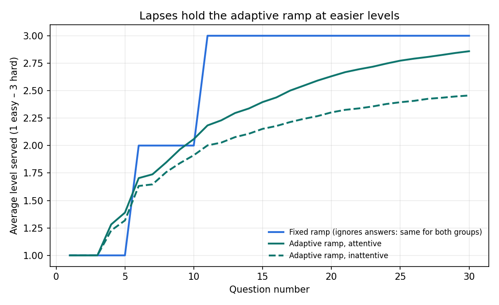

# Neuro-Learn — Evaluation 2: inattentive learners

> Run on 2026-11-12. Companion to **Evaluation 1** ([evaluation.md](evaluation.md)), which compares the
> difficulty policies on attentive students. This study uses the same simulator, policies, populations and
> random draws, and adds attention lapses.
> Code: `backend-java/src/main/java/com/neurolearn/evaluation/` · Data and charts:
> [`docs/evaluation/attention/`](evaluation/attention/)
> **This is a simulation study.** No real students were involved, and the lapse model is a stress test of
> the policies, not a model of ADHD.

---

## 1. Summary

1. **Question.** NeuroLearn began as an attention-focused (ADHD-friendly) project. Does adaptive difficulty
   help students whose wrong answers are sometimes caused by a lapse in attention rather than missing
   knowledge?
2. **Lapses hurt every policy, and the adaptive ones most.** With lapses, mastery within 30 questions drops
   from 73.4% to 52.1% on the fixed ramp, but from 69.7% to **35.0%** on the adaptive ramp.
3. **The fixed ramp gets the most inattentive students to mastery** (52.1%; with quitting 24.1% vs 19.9%).
4. **The adaptive ramp is still the kinder policy.** It serves about half as many too-hard questions
   (27.7% vs 50.0%), loses **9 points fewer** students when they can quit (59.0% vs 68.0%), and leaves
   students with slightly *higher* average ability (1.90 vs 1.87).
5. **Why:** every adaptive policy reacts to wrong answers, and lapse-driven misses say nothing about
   knowledge. The adaptive ramp reads them as "not ready" and holds students at easier levels: by question
   30 it serves inattentive students an average level of **2.46**, against 2.86 for attentive students and
   3.00 on the fixed ramp.
6. **What it means:** an attention-aware tutor must tell a lapse from a gap in knowledge. NeuroLearn already
   logs response time per answer, which is the most promising signal (§5).

---

## 2. Why this study

Evaluation 1 found that adaptivity mostly helps the students a fixed sequence loses: weak starters and
students who give up after repeated failure. Students with attention difficulties are the group the project
was originally designed for, and their defining pattern is different: they often *know* the material but
miss questions because their attention drifts, more so as a session goes on. A policy that adapts to wrong
answers could therefore help them (fewer frustrating questions) or hurt them (holding them back for
mistakes that aren't about knowledge). This study measures which.

---

## 3. Method

### 3.1 Same set-up as Evaluation 1

- **Policies:** fixed ramp, original engine (BKT cut-offs), tuned engine, difficulty-aware Elo, ramp with
  remediation, adaptive ramp, random. Definitions: [evaluation.md §2](evaluation.md#2-what-was-compared).
- **Simulated student:** ability θ, item difficulty for levels 1–3, guessing and slipping, learning that
  peaks on items a little above the student. Details: [evaluation.md §3.1](evaluation.md#31-simulated-student-ground-truth-the-engine-cannot-see).
- **Population and run:** 5,000 students (test population, seed 42), 30 questions each, one topic.
- **Fair comparison:** every student is replayed under every policy with the same starting ability,
  learning rate and random draws (for answers, quitting and lapses).

### 3.2 The lapse model (added for this study)

| Part | Model |
|---|---|
| Lapse chance | On question *t*, the student is off-task with probability min(0.50, 0.10 + 0.01·(*t* − 1)): 10% at the start, rising one point per question as fatigue builds (39% by question 30, about 25% on average) |
| Off-task answer | An impulsive guess: right with probability 0.25 (4 options), whatever the student knows |
| Learning while off-task | None: ability does not change |
| Policy's view | The policy only sees right/wrong, exactly as in the app; it cannot see whether the student was attentive |

These rules were written down **before** running and nothing was tuned. Lapse draws use their own random
stream, so turning lapses off reproduces Evaluation 1 exactly (checked by a unit test).

### 3.3 Scenarios

| Scenario | Lapses | Quitting (after *k* wrong in a row, quit with probability 0.04·*k*) |
|---|---|---|
| Attentive (baseline) | off | off |
| Attentive + quitting | off | on |
| **Inattentive** | on | off |
| **Inattentive + quitting** | on | on |

The two attentive scenarios are the same as in Evaluation 1, repeated here as reference points.

### 3.4 Metrics

- **Mastered by Q30:** share of students whose *true* ability reached mastery (≥ 70% expected accuracy on
  level-3 items).
- **Too hard:** share of questions the student, *if attentive*, had < 50% chance of answering correctly.
  Measured on the attentive chance so a lapse is not blamed on the policy's choice of level.
- **Final ability:** average θ after 30 questions (how much was learned, whether or not mastery was reached).
- **Quit:** share of students who stopped early (quitting scenarios only).

---

## 4. Results

### 4.1 Mastery: attentive vs inattentive

Mastered by question 30:

| Policy | Attentive | **Inattentive** | Drop | Attentive + quitting | **Inattentive + quitting** |
|---|---|---|---|---|---|
| Fixed ramp | **73.4%** | **52.1%** | −21.3 | 42.3% | **24.1%** |
| Original engine | 61.2% | 28.2% | −33.0 | 37.6% | 16.1% |
| Tuned engine | 64.1% | 36.1% | −28.0 | 35.2% | 18.4% |
| Difficulty-aware Elo | 60.0% | 28.4% | −31.6 | 37.1% | 17.2% |
| Ramp with remediation | 48.2% | 13.6% | −34.6 | 33.5% | 8.7% |
| Adaptive ramp | 69.7% | 35.0% | −34.7 | **44.3%** | 19.9% |
| Random | 25.4% | 8.4% | −17.0 | 15.3% | 4.1% |



The fixed ramp loses the least, because it never reacts to answers. Every policy that reacts to wrong
answers loses 28–35 points.

### 4.2 Inattentive learners in detail

| Policy | Mastered by Q30 | Too hard | Final ability θ | Median Q to mastery |
|---|---|---|---|---|
| Fixed ramp | **52.1%** | 50.0% | 1.87 | **22** |
| Original engine | 28.2% | 40.0% | 1.68 | 23 |
| Tuned engine | 36.1% | 49.3% | 1.69 | 22 |
| Difficulty-aware Elo | 28.4% | 31.6% | 1.65 | 22 |
| Ramp with remediation | 13.6% | **19.2%** | 1.50 | 24 |
| Adaptive ramp | 35.0% | 27.7% | **1.90** | 24 |
| Random | 8.4% | 47.0% | 1.18 | 26 |

The fixed ramp gives inattentive students a too-hard question half the time. The adaptive ramp halves that
and ends with the highest average ability, but fewer students cross the mastery line within 30 questions.

### 4.3 When students can quit

| Policy | Quit early | Mastered by Q30 | Final ability θ |
|---|---|---|---|
| Fixed ramp | 68.0% | **24.1%** | 0.93 |
| Original engine | 59.5% | 16.1% | 0.82 |
| Tuned engine | 67.2% | 18.4% | 0.64 |
| Difficulty-aware Elo | 61.0% | 17.2% | 0.72 |
| Ramp with remediation | **54.8%** | 8.7% | 0.86 |
| Adaptive ramp | 59.0% | 19.9% | **1.05** |
| Random | 68.3% | 4.1% | 0.32 |



By question 30, 41% of adaptive-ramp students are still practising against 32% on the fixed ramp. The
adaptive ramp keeps more students and teaches the group the most on average; the fixed ramp gets more of
the students who stay all the way to mastery.

### 4.4 Why: lapses hold the adaptive ramp back



| Average level served at question 30 | Fixed ramp | Adaptive ramp |
|---|---|---|
| Attentive | 3.00 | 2.86 |
| Inattentive | 3.00 | **2.46** |

The adaptive ramp moves down after 3 wrong answers in a row and pauses after 2. Lapses become more frequent
as fatigue builds, so wrong streaks appear late in the session, exactly when the student should be on hard
questions. In this model learning happens on attempts slightly above the student and mastery is measured on
level-3 items, so time spent at level 2 delays mastery.

---

## 5. Discussion

- **For the average attentive student,** Evaluation 1 already showed a well-designed fixed sequence is as
  good as adaptivity. **For inattentive students** the picture is mixed: the fixed ramp is better at
  mastery, the adaptive ramp is gentler and keeps more students.
- **Which matters more depends on the goal.** If the goal is reaching mastery within a fixed number of
  questions, the fixed ramp wins. If the goal is a session the student finishes without repeated failure,
  the adaptive ramp wins. For students prone to frustration, many teachers would accept slower progress
  for fewer drop-outs, but that is a judgement this simulation cannot make.
- **The real lesson is about the signal, not the policy.** Treating every miss as missing knowledge is the
  weakness. A lapse-aware policy would discount misses that look like lapses. Candidate signals, all
  untested:
  1. **Response time:** off-task answers are often much faster (impulsive) or much slower (drifting) than
     the student's usual time. NeuroLearn already stores `response_time_ms` on every attempt.
  2. **Record at that level:** a miss on a level the student has answered correctly several times is more
     likely a lapse.
  3. **Position in the session:** misses late in a long session are more likely fatigue; a short break
     may help more than easier questions.
- **Next step:** write a lapse-aware rule down first, add response time to the simulator, and test it in
  these scenarios the same way, before it goes near the app.

---

## 6. Threats to validity

- **Simple lapse model.** One fatigue slope for everyone, independent lapses, no recovery after breaks, no
  link between lapses and frustration. Real attention varies far more between students and days.
- **Not a model of ADHD.** Lapses are one observable pattern; this study says nothing about diagnosis, and
  NeuroLearn deliberately does not label students (README, Decision November 2026).
- **All of Evaluation 1's caveats apply:** simulated learning, one topic, 30 questions, assumptions chosen
  by the authors.
- **Partly informed by Evaluation 1.** The adaptive ramp was designed after Evaluation 1; this study was
  run once with rules fixed in advance, and its result went against that policy on mastery.

---

## 7. What a pilot could check

On top of the pilot design in [evaluation.md §7.1](evaluation.md#71-pilot-design-what-the-app-supports-today)
(two classes, one per strategy):
- Compare outcomes for students whose answers show lapse patterns: unusually fast or slow responses, misses
  on levels already answered correctly.
- This study predicts the fixed-ramp class gets more of them to mastery and the adaptive-ramp class keeps
  more of them going; the pilot can check both.
- Analysis is on class-level and anonymised data only, consistent with the project's privacy decision.

---

## 8. Reproduce

From `backend-java/` (JDK 17+; no database needed):

```bash
./mvnw -q compile
java -cp target/classes com.neurolearn.evaluation.EvaluationRunner simulate ../docs/evaluation/attention 5000 30 42 attention
cd ../docs/evaluation/attention && python make_charts.py
```

Unit tests: `EvaluationModelTest` checks the lapse model (rising with fatigue, capped, off by default; an
off-task answer is a 25% guess and teaches nothing). `EvaluationRunnerTest` checks the attention scenario
set and that its attentive reference rows match Evaluation 1 exactly.
